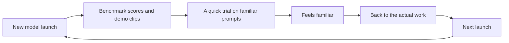
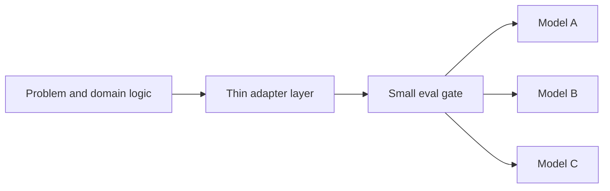

> This post started as a personal observation of mine; the research and the writing were done with AI. I do not guarantee the accuracy of the information presented.

# Hype-Driven Development: Why Model Launches Stopped Feeling Like Events

Another frontier model shipped recently. The benchmarks looked great. The launch thread made the usual rounds. And the group chats that used to light up for hours on release days stayed mostly quiet, until someone asked whether anyone had even tried it yet.

That silence is becoming a pattern. Release days increasingly read like product updates rather than events, and the outputs of the new models feel strangely familiar: not just competent, but familiar.

The feeling is measurable, and it belongs to no one in particular. Microsoft's 2025 Work Trend Index surveyed 31,000 knowledge workers and found 68% struggling with the pace and volume of work, and 46% reporting burnout. Stack Overflow's 2025 developer survey (around 49,000 respondents) shows AI usage at 84% while favorable sentiment fell to 60%, and more developers actively distrust the accuracy of AI tools (46%) than trust them (33%). People are not abandoning these tools. They are just... tired.

Taking that tiredness seriously instead of dismissing it raises three questions:

> Are the models really converging into interchangeable copies of each other? Why do the launches still hook their audience anyway? And what does a sound engineering posture look like on top of all this?

## 1. The sameness is measurable, with limits

The intuition that models produce similar outputs is not just vibe-based anymore. A NeurIPS 2025 paper called _Artificial Hivemind_ (Jiang et al.) tested this at scale: 26,070 real, open-ended user queries, the kind with no single right answer, run across more than 70 models.

The results are worth sitting with:

- Even at high sampling settings (temperature 1.0, top-p 0.9), in **79% of cases** a single model's own 50 responses to the same prompt had an average pairwise similarity above 0.8.
- Across different model families, average response similarity ranged from **0.71 to 0.82**. DeepSeek-V3 and qwen-max reached 0.82; DeepSeek-V3 and GPT-4o reached 0.81.
- Asked to "write a metaphor about time", 25 models produced 1,250 responses that cluster into essentially two ideas: _time is a river_ and _time is a weaver_.
- Some pairs produced verbatim overlapping phrases. For one social-media motto prompt, two different models produced the identical slogan, word for word.

Now the limits, because they matter. This study is about open-ended, creative prompts; 58% of the queries were creative content generation. Other work shows homogenization is task-dependent: in objective tasks we often _want_ convergence on the same answer, and some models (GPT-4, in one large analysis) remain notably more varied than others. "Strikingly similar" is a supported claim. "Copies of each other" is not.

There is also harder market-level evidence that the top of the field is compressing. Stanford's AI Index 2025 reported that the Elo gap between the #1 and #10 models on the Arena leaderboard fell from 11.9% to 5.4% within a year, and the top two models were separated by just 0.7%. (The 2026 edition adds an honest wrinkle: the gap between closed and open models briefly closed, then reopened to 3.3%. The trend is compression, not a flat merge.)

## 2. Why models converge: plausible mechanisms, honestly labeled

When you ask _why_ models sound alike, the honest answer is that the research does not fully agree yet. Here are the four explanations that come up most, each with its correct label.

**Shared training data.** Everyone trains on overlapping scrapes of the internet, and increasingly on data generated by other models. Same inputs, similar priors. This one is the least controversial of the four.

**RLHF narrows the distribution** _(empirical finding)_. Kirk et al. (ICLR 2024) showed that training from human feedback improves out-of-distribution generalisation while substantially reducing output diversity: a collapse toward narrower, more central, more agreeable responses. Reward models tend to prefer the safe, well-formatted, middle-of-the-road answer, so that is what survives. Related work by Sharma et al. found that both humans and preference models sometimes prefer convincingly-written sycophantic responses over correct ones, which quietly trains models to be persuasive rather than right.

**Synthetic data loops** _(a conditional risk, not an observed collapse)_. Shumailov et al. in _Nature_ (2024) showed that models trained recursively on their own outputs lose the tails of their distribution. But a follow-up by Gerstgrasser et al. found that collapse appears when synthetic data _replaces_ real data, and disappears when it _accumulates_ alongside it, which is closer to how labs actually train. So the honest sentence is: recursive collapse is a demonstrated risk scenario, not a description of today's frontier.

**The Platonic Representation Hypothesis** _(a hypothesis)_. Huh et al. (ICML 2024) argue that as models scale and are trained on more tasks, their internal representations converge: there are only so many ways to represent the same statistics of the world. It is a fascinating result, and worth remembering it concerns _representations_, not outputs. Similar internals is consistent with similar outputs; it does not guarantee them.

A 2026 preprint pushes the question further back: it traces semantic convergence to the pretraining stage, suggesting alignment reveals homogeneity more than it creates it. The causes are still being argued. That honesty is worth more than a tidy story: any single-cause explanation is running ahead of the research.

One more finding worth a sentence: it is not only style that converges. Santurkar et al. (ICML 2023) measured whose _opinions_ models reflect, and found that RLHF-tuned models mirror a narrower slice of the population than the base models underneath them.

## 3. The benchmark game: a contested story

If outputs converge and releases blur together, why do leaderboards still move markets? Because leaderboards are also a game, and the best study of that game is itself contested, which is exactly why it is worth telling carefully.

_The Leaderboard Illusion_ (Singh et al., 2025; several authors work at Cohere, whose models compete on the same board, worth knowing) analyzed Arena data and found:

- Meta tested **27 private model variants** on the Arena before the Llama-4 release, publicly releasing only the best-scoring one.
- Proprietary providers got disproportionate data access: Google an estimated 19.2% and OpenAI 20.4% of all Arena data, while 83 open-weight models _combined_ received 29.7%.
- Access to that distribution is valuable: their conservative estimate puts fine-tuning gains at up to **112% relative** on the Arena's own distribution.

LMArena pushed back in an official response: resubmitting the same checkpoint lands within confidence intervals, sampling policy favors the best models regardless of provider, and anyone can submit as many tests as they like. The two sides genuinely disagree about the framing.

Here is what is _not_ contested, because the platform's own analysis showed it. LMSYS's style-control work found that when you statistically control for answer length and markdown formatting, the rankings shift noticeably: GPT-4o-mini drops below frontier models, Claude rises, and length turns out to be the dominant factor.

A separate research group showed the leaderboard can be moved by orchestrated vote rigging (about four ranks, even on the length-controlled version). And attribution runs deeper than voting: wrap an older model in a newer agent harness and its benchmark scores climb dramatically, so when model, scaffolding and tooling all improve together, the score delta stops being a model delta.

The law everyone quotes was put best not by Goodhart himself but by anthropologist Marilyn Strathern in 1997: _when a measure becomes a target, it ceases to be a good measure._

Put together, the reasonable takeaway is modest and useful: a leaderboard can tell you who is in the top cluster. It cannot tell you which model fits a given task, dataset, latency budget or price point. For that, only the project's own measurements will do.

## 4. Why we keep watching anyway

None of the above explains the launch-day reflex.

**Novelty and variable rewards.** New things capture attention automatically: that is the orienting response, and it is not a character flaw. Worse, launch cycles are variable-reward machines: "is this one actually different?" has an unpredictable answer, and unpredictable rewards are precisely the schedule that keeps behavior persistent. A launch stream runs on the same schedule as a slot machine.

**FOMO, including at work.** Fear of missing out has a real literature since Przybylski et al. (2013): apprehension that others are having rewarding experiences you are absent from, plus the compulsion to stay connected. The more useful version for this story is organizational: Mari and Mandelli studied decision-makers adopting emerging technology and found FOMO influences decisions both directly and by inflating expected outcomes. Their merciful conclusion: the mere presence of FOMO is not itself a bias. Feeling it is human. What it does to estimates is the part worth watching.

**Attention is the scarce resource.** Herbert Simon saw this in 1971: _a wealth of information creates a poverty of attention._ Gloria Mark's research group measured the cost of that poverty: after an interruption it takes people 23 minutes and 15 seconds on average to return to the original task (82% do get back to it the same day), and her two decades of field studies trace average attention on any single screen down to around 47 seconds. A feed engineered around launches is an interruption machine aimed at exactly this weakness.

Every lap of this loop spends attention. None of it, by itself, ships anything.

**Explore versus exploit.** A kinder framing comes from neuroscience and decision theory: the explore-exploit trade-off (Cohen, McClure and Yu have a lovely 2007 paper on how the brain manages it). Trying the new model is exploration. Finishing the product is exploitation. Both are necessary; a builder who never explores calcifies, and one who only explores ships nothing. Whether to try the new model is therefore not a moral question. It is a budget question, and the launch cycle is engineered to make that budget invisible.

## 5. Why the noise is structural

It is tempting to narrate all this as a scam. It is more accurate, and more useful, to narrate it as incentives.

Model companies profit when you default to their frontier. As Moe Khalil put it after a week of overlapping "world's most advanced" launches: their job is to keep pushing the frontier; figuring out when _not_ to use the frontier is left to you. For the companies, your inertia is a feature, not a bug.

Overstatement is now a regulated category. In March 2024 the SEC brought its first "AI-washing" enforcement actions: two investment advisers paid a combined $400,000 for claiming AI capabilities they did not have.

Academic audits are catching up: a University of Hamburg study of 100 German startups found 76 of them named no limitations of their AI anywhere in their marketing. Gartner estimates that of the thousands of vendors branding themselves "agentic AI," only about 130 are real (their term is _agent washing_), and predicts over 40% of agentic AI projects will be canceled by the end of 2027, citing escalating costs and unclear value.

Meanwhile the money and the mood point in opposite directions, which is the strange part: Gartner's own hype cycle has generative AI sliding into the trough of disillusionment since mid-2025, while AI spending is projected to keep climbing into the trillions. A widely quoted 2025 MIT-affiliated report claimed 95% of organizations saw zero return from GenAI pilots; it is not peer-reviewed, drew methodological pushback, and spread anyway; the fact that it spread so fast is itself evidence about the mood.

The strongest counter-argument runs like this: capability moves in waves (train a large model, distill it into smaller ones, improve, repeat), and a genuine step-change, perhaps recursive self-improvement, could arrive any cycle now and make all of this look quaint. It could. Nothing in this post depends on it being wrong; that is the point of the architecture in the next section. If a step-change lands, an eval gate catches it on real tasks within the hour, and a thin adapter turns adoption into an afternoon, a cheaper early-warning system than watching every launch in between. A stance that survives both futures beats a prediction that only survives one.

And underneath the noise, the economics quietly commodified:

- Stanford's AI Index 2025: the cost of running a GPT-3.5-level model fell from $20 to $0.07 per million tokens in about 18 months, a 280x drop.
- Epoch AI measured price declines at a median of 50x per year for fixed benchmark performance (range: 9x to 900x).
- An independent academic analysis (Demirer, Fradkin and Tadelis, 2026) gets more conservative numbers: roughly 5-10x per year, up to ~32x for frontier-level performance.

The ranges disagree; the direction does not. Capable intelligence is getting cheap fast. Last year's frontier is becoming this year's commodity. We do not rewrite our stack every time PostgreSQL ships a point release, and we are nearing the point where treating models the same way (as capable, boring, swappable infrastructure) is the mature move rather than the cynical one.

## 6. The quiet pattern: eval gates and swappable models

Across teams and solo builders who have quietly stopped optimizing for launch days, a recognizable pattern shows up. It is less a manifesto than an architecture, and it keeps resolving into the same few pieces.

**A small eval set drawn from real work.** A few dozen prompts from the actual workload: the awkward ones, the ones with weird constraints. Every new model runs against that set before anything else. It takes minutes, and it beats any leaderboard because the distribution is the builder's own. Given style bias, vote-rigging demos and task-dependence, measuring on your own distribution is not paranoia; it is the only measurement that answers the actual question.

**The model sits behind a thin adapter.** The application talks to a small interface, backed by whichever model currently passes the eval gate. Swapping is a configuration change, not a rewrite:

This is the PostgreSQL attitude from the previous section, expressed in code. Models are the most volatile dependency in a modern stack; the adapter exists to make them the cheapest to replace.

**The good-enough threshold as default.** Most everyday workloads have been served well by models that are, at this point, months old. The upgrades are real, but they are refinements, and the eval gate, not the launch stream, is what decides when a switch is worth making.

**Innovation tokens spent deliberately.** Dan McKinley's old idea (a project gets a few "innovation tokens," spent where the product is actually novel) aged beautifully into the AI era. There is even a twist: boring, well-documented technology is massively represented in training data, so AI tooling handles it best. Every token spent on an exotic dependency is now taxed twice: once for the team to learn it, once for the tools to hallucinate about it.

**Exploration on a schedule, not on a trigger.** Launch-day curiosity survives; it just stops scheduling itself. New models get attention when the eval set needs refreshing, not when a notification says so. Exploration becomes a line item, not a lifestyle.

## Conclusion

The models are fine. Better than fine: cheaper every quarter, close enough at the top that the choice matters less every year, and measurably homogenous in the open-ended tasks where variety matters most.

None of that is a reason for despair. It is a reason to relocate the interesting part of the job. The differentiation was never really which model gets picked; it is the problem being solved, the data and domain logic wrapped around it, the boring reliability engineering nobody demos on stage, and where the scarce attention goes.

The gruffest objection to this line of thinking also proves the most encouraging: people are building genuinely useful things all around (runtimes, browsers, kernel patches, entire security audits), and a sea of noise buries them. Read closely, that is not a rebuttal. It is the thesis. The quiet builders were never the exception to the hype economy; they are the bet the hype is shouting over. Betting with them has the better odds.

The next launch will still be there tomorrow morning.

So is the work that outlasts the cycle.
